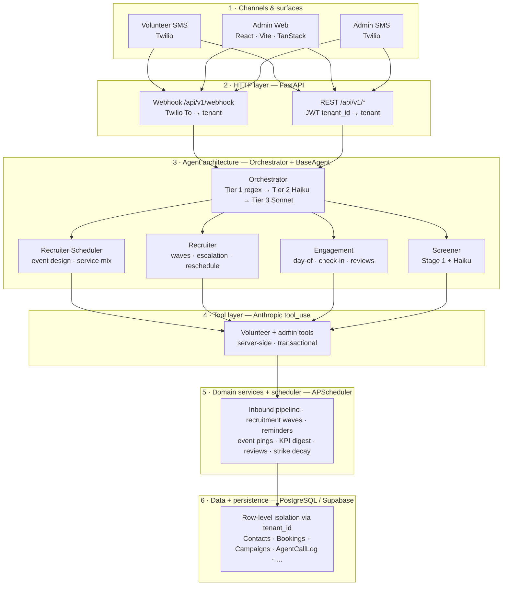
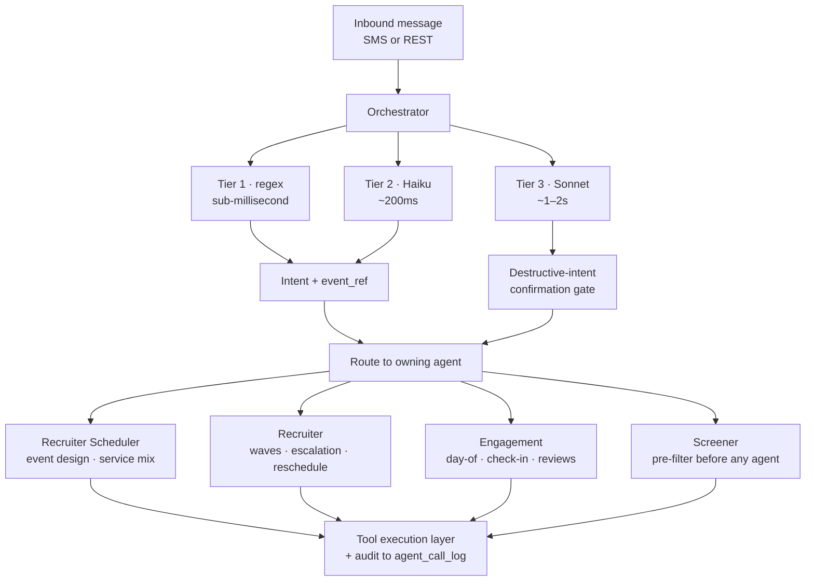
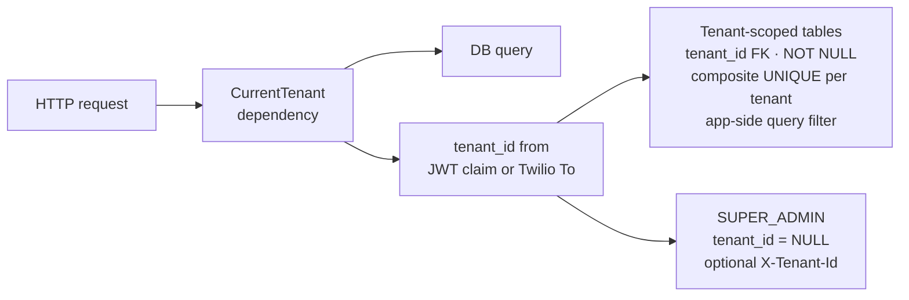

# Architecture

End-to-end architecture of the shipped system. For features and usage, see the [root README](../README.md).

---

## At a glance

A multi-tenant SaaS that coordinates volunteers over plain SMS. The system is split into six horizontal layers:

1. **Channels & surfaces** — how volunteers and admins reach the system.
2. **HTTP layer** — FastAPI app with webhook + REST transports, multi-tenant resolution.
3. **Agent architecture** — orchestrator + per-domain agents on a hybrid intent stack.
4. **Tool layer** — Anthropic `tool_use` loop, deterministic server-side execution.
5. **Domain services + scheduler** — recruitment waves, reminders, event lifecycle, KPI digest.
6. **Data + persistence** — multi-tenant PostgreSQL with row-level isolation.

Cross-cutting: per-tenant credentials for external services (Twilio, Anthropic, Google, Resend).

---

## End-to-end diagram

---

## Cross-cutting

### External integrations (per-tenant credentials)

| Service          | Used for                                       |
|------------------|-------------------------------------------------|
| Anthropic Claude | Haiku 4.5 (routing) + Sonnet 4.6 (reasoning)   |
| Twilio           | SMS send/receive with signature validation     |
| Google Calendar  | ICS exports + OAuth2 event sync                |
| Resend           | Transactional email                            |

### Trust & guardrails

- **Hybrid intent stack** — regex → Haiku → Sonnet, with always-confirm on destructive intents (`delete_campaign`). Holds per-tenant LLM cost predictable.
- **Two-stage pre-screener** — deterministic Stage 1 (opt-out, garbage, prompt injection) + Haiku Stage 2 (RELEVANT / IRRELEVANT / ABUSIVE) with contextual-reply bypass so brief answers to assistant questions ("anything", "idk") aren't punished.
- **Fresh-state preamble** — every admin turn re-injects current system state (~250 tokens) so the LLM can't parrot stale conversation history.
- **Per-tenant LLM rate limit** — request-per-minute ceiling at the application layer; clean 429 with retry-after.
- **Bounded conversation history** — sliced before every LLM send (per-turn cost cap) AND FIFO-trimmed in storage.
- **Editable prompts** — 17 system prompts editable per tenant, with "reset to shipped default" when overrides drift.
- **Agent call audit** — every orchestrator routing decision + tool call writes to `agent_call_log` under a shared `turn_id`, surfaced as a per-conversation Trace tab.
- **SMS suppression flag** — per-tenant kill switch for testing without burning Twilio credits.

### Multi-tenant operations

- `Tenant` model holds per-tenant Twilio, Anthropic, Google, Resend credentials.
- Tenant resolution at webhook: Twilio `To` phone → tenant.
- Tenant resolution at REST: JWT `tenant_id` claim.
- `SUPER_ADMIN` role above `OWNER`; manages tenants and platform-level config; `tenant_id` is `NULL`.
- Scheduler iterates active tenants per tick.
- `is_active` / `is_paused` flags gate request handling at the dependency layer.

---

## Detail: Agent layer

Each agent ships with the same four-file shape: `planner.py` (decides what to do), `executor.py` (does it), `reporter.py` (renders the result), `intents.py` (declares which intents it owns). Code lives under [backend/app/agents/](../backend/app/agents/).

---

## Detail: Data isolation

---

## What this diagram doesn't cover

- **Frontend internals** — tanstack-query keys, shadcn/ui composition, Recharts pipelines. Lives in [frontend/](../frontend/), not on the architectural critical path.
- **Per-intent sequence diagrams** — book, reschedule, switch, check-in — captured in code rather than diagrams.
- **Operational concerns** — CI/CD, monitoring, alerting. Lightweight by design (Supabase dashboard + GitHub Actions).

For the eval framework that gates changes to any of this, see [eval-framework.md](eval-framework.md).
